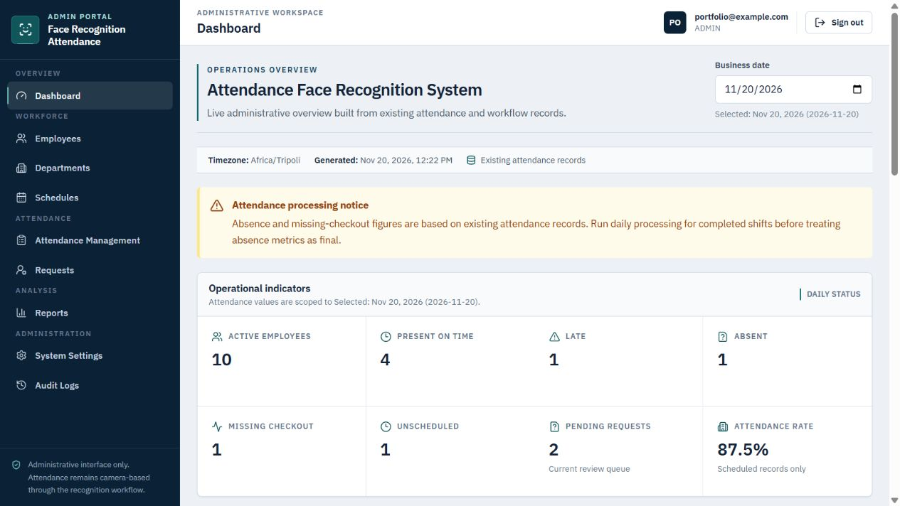
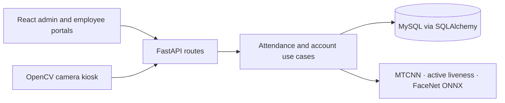

# Face Attendance System

A full-stack graduation project that records employee check-ins and check-outs through a camera kiosk. Administrators manage people, schedules, attendance and reports in a web portal. Employees use a separate portal to review their records and submit requests.

[](https://github.com/Yahia4083/face-attendance-system/actions/workflows/ci.yml)

[Local demo](#local-demo) · [Architecture](#architecture) · [Camera kiosk](#camera-kiosk) · [Tests](#tests)

## Admin dashboard



Both portals use fictional employees and attendance records generated by the [demo seeder](scripts/seed_demo_data.py). [View the employee portal](docs/screenshots/employee-portal.jpg).

## What you can do

| Area | Workflows |
| --- | --- |
| Administration | Manage employees and departments, assign shifts, apply attendance corrections, review audit activity, and export CSV or XLSX reports. |
| Employee portal | View personal attendance and schedules, download reports, and submit overtime or attendance justification requests. |
| Camera kiosk | Complete a randomized head-turn challenge and use FaceNet to identify an enrolled employee. The backend applies schedule rules to choose check-in or check-out. |
| Attendance processing | Mark eligible absences and missing check-outs and surface those records for administrators. |

## Architecture



| Path | Responsibility |
| --- | --- |
| [app/domain](app/domain) and [app/application](app/application) | Business rules, repository interfaces and use cases. |
| [app/presentation](app/presentation) | FastAPI endpoints and request and response schemas. |
| [app/infrastructure](app/infrastructure) | Database repositories, biometric adapters, authentication and report exports. |
| [frontend](frontend) | React and TypeScript portals with Vite and Tailwind CSS. |
| [migrations](migrations), [scripts](scripts) and [tests](tests) | Alembic database schema, demo setup and automated tests. |

## Local demo

Use **Python 3.14**, **Node.js 24** and **MySQL 8.4**. The portals and demo data run without a camera or model weights. Clone the repository and set up the backend in PowerShell.

```powershell
git clone https://github.com/Yahia4083/face-attendance-system.git
cd face-attendance-system
py -3.14 -m venv .venv
.\.venv\Scripts\Activate.ps1
python -m pip install -r requirements.txt
Copy-Item .env.example .env
```

Create an empty local database and a dedicated user using MySQL Workbench or an administrative MySQL session. Replace the password in the SQL before running it.

```sql
CREATE DATABASE attendance_face_system CHARACTER SET utf8mb4 COLLATE utf8mb4_0900_ai_ci;
CREATE USER 'attendance_app'@'127.0.0.1' IDENTIFIED BY '<database-password>';
GRANT ALL PRIVILEGES ON attendance_face_system.* TO 'attendance_app'@'127.0.0.1';
```

Update `DATABASE_URL` and set your own `ADMIN_PASSWORD` in `.env`. Percent-encode any URL-reserved characters in the database password. Replace `SECRET_KEY` with a random value generated by `python -c "import secrets; print(secrets.token_urlsafe(48))"`.

```powershell
python -m alembic upgrade head
python -m scripts.create_admin
python -m scripts.seed_demo_data
python -m uvicorn app.main:app --host 127.0.0.1 --port 55000
```

Open a second PowerShell window at the repository root and start the frontend.

```powershell
cd frontend
npm ci
npm run dev
```

| Entry point | How to try it |
| --- | --- |
| [Admin portal](http://127.0.0.1:5173/login) | Sign in with `ADMIN_EMAIL` and `ADMIN_PASSWORD` from `.env`. Open **Attendance** to review the seeded late, absent and missing check-out records. |
| [Employee portal](http://127.0.0.1:5173/employee/login) | Sign in locally as `demo.amal@example.com` with `Demo123!`. Open **My Attendance** or **My Requests**. |
| [API documentation](http://127.0.0.1:55000/docs) | Browse the OpenAPI schema. [The health endpoint](http://127.0.0.1:55000/health) checks that the API process responds. |

## Camera kiosk

For live recognition, use a USB camera or a configured camera stream and place the [upstream FaceNet ONNX model](https://huggingface.co/haikalmumtaz/facenet-onnx/blob/cd2a9112e93815f408c3c3aa1218ff78f59e043c/facenet.onnx) at `storage/models/facenet/facenet.onnx`. Enroll a consenting test participant in the admin portal, then run the readiness check and start the worker alongside the API.

```powershell
python tools/check_live_attendance_readiness.py
python tools/live_mobile_attendance_kiosk.py
```

In the kiosk, select **Start Attendance** or press `Space` and follow the head-turn prompt. Press `Q` to exit.

This prototype uses active liveness during attendance. Passive presentation-attack detection is available for offline evaluation. The kiosk uses an administrator session, and live frames are processed without being stored by default. See the [biometric evaluation notes](docs/biometric_security.md) for the evaluation workflow and its limitations.

## Tests

From the repository root, run the backend suite and the production frontend build. GitHub Actions runs both checks on pushes and pull requests targeting the main branch.

```powershell
python -m pytest -q
cd frontend
npm ci
npm run build
```
